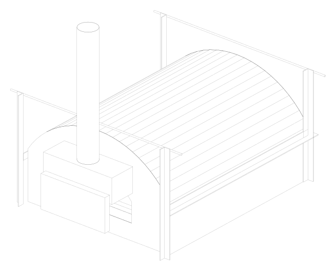
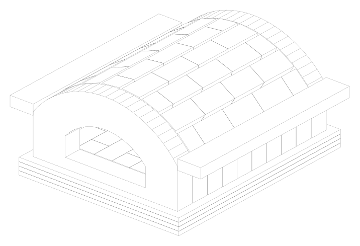

# Flat-pack wood-fired pizza oven

A real, buildable wood-fired oven for Neapolitan-style pizza, taken from requirements to a
verified design by Claude Code, with a human builder in the loop. Every material
property has a source, every solver is checked against known solutions before use, and
uncertainty is reported, not hidden. The prototype will be built and fired
outdoors in Romania. The measurements from that firing will be used to calibrate the model.

<p align="center">
  
  
</p>

> **Status:** Phase 3 (detailed design) is complete and waiting for review. Nothing has been
> built or fired yet. All performance numbers below are **model predictions**. See
> [Safety](#safety-read-this-before-building) before building anything.

---

## The oven at a glance

**Concept B:** a firebrick barrel vault held in a bolted steel frame, on a concrete base you
build yourself. Decisions are recorded in [docs/decisions/](docs/decisions/).

| | |
|---|---|
| Use | Neapolitan-style pizza, one pizza up to **45 cm**. Fire burns along the back wall. |
| Cooking floor | 798 × 920 mm, local fireclay bricks laid flat. Floats on 125 mm of calcium-silicate board. |
| Vault | Segmental barrel arch, 8 courses of 64 mm bricks, span 808 mm. Crown 359 mm above the floor. |
| Door | 520 mm wide, 240 mm high, segmental brick arch. Insulated steel door for curing and retention. |
| Insulation | 50 mm Superwool Plus (bio-soluble fibre) + 100 mm ROCKWOOL ProRox WM 960ES |
| Frame | Steel angles, tie rods and disc springs, all **outside** the insulation. The arch thrust reaches them through calcium-silicate strips. |
| Shell | Pre-painted 0.5 mm steel sheet over the barrel, 1 mm end panels, Ø150 mm flue on a hood in front of the door |
| Size and mass | About 1.44 × 1.86 m on the base, 0.76 m tall plus flue. **606 kg**. Heaviest single part is one brick, about 3.4 kg. |
| Materials | About 150 Refarom 65 SA bricks (made in Brașov), Helios refractory mortar, CaSi boards: mostly from Romanian DIY stores |

### Predicted performance (model, see the caveats in the reports)

| | Prediction | Requirement |
|---|---|---|
| Wood to hold a 450 °C floor | **≈ 1.5 kg/h** (about ±20 % from the sensitivity study, so ≈ 1.2–1.8) | informative |
| Vault temperature at that point | ≈ 530 °C | design 550 °C |
| Heat-up to 430 °C floor at 9 kg/h | ≤ 114 min (**pessimistic upper bound**; real expected 60–120 min) | ≤ 90 min, to verify at first firing |
| Outer shell, 40 °C day, long session | 59 °C | ≤ 60 °C |
| Arch stability | geometric safety factor 8.5; no joint opens | — |
| Thermal expansion to absorb | 3–5 mm per direction | joints and springs designed for it |

### Budget

About **1000 USD** for materials, excluding the concrete base, the roof and the measurement kit.
So far **752 USD is priced** from dated supplier listings, and 15 lines (steel, rock wool,
hardware) are waiting for local quotes. See [bom/bom.md](bom/bom.md).

---

## How the project is organised

The work runs in phases. Each one ends with a written report and a stop for human approval.

| Phase | Content | Report |
|---|---|---|
| 0 | Setup, requirements, rules | [phase-0](docs/reports/phase-0.md) |
| 1 | Research, sourced materials database, 3 concepts | [phase-1](docs/reports/phase-1.md) |
| 2 | Verified thermal model, calibration on a published oven, predictions, sensitivity | [phase-2](docs/reports/phase-2.md) |
| 3 | Parametric CAD, bill of materials, cut list, DXF templates, arch statics | [phase-3](docs/reports/phase-3.md) |
| 4 | Assembly instructions, curing and first firing, measurement plan | *next* |
| 5 | Build, measure, calibrate the model, lessons for v2 | *later* |

### Working rules (the full list is in [CLAUDE.md](CLAUDE.md))
- **No invented numbers.** Every material property is in
  [materials/materials.yaml](materials/materials.yaml) with its source, access date,
  confidence (DATASHEET / REFERENCE / ASSUMPTION) and an uncertainty band. Datasheets are
  saved in [materials/sources/](materials/sources/). The loader refuses entries without a source.
- **Verify before trusting.** Every solver is tested against analytical solutions before it
  is applied to the oven.
- **Ranges, not single numbers**, and a running [risks and unknowns list](docs/risks.md).
- **Requirements** live in [requirements/requirements.yaml](requirements/requirements.yaml)
  and change only by approved amendment.

### Repository layout
```
requirements/   requirements.yaml - IDs, values, status, verification method
materials/      materials.yaml (sourced properties + prices), db.py (loader/validator), sources/ (datasheets)
geometry/       oven_b.py (parametric CadQuery model), end_walls.py, arch_statics.py, export.py, interfaces.py, out/ (STEP, SVG)
simulation/     conduction, radiation, fire, oven model, scenarios, sensitivity, as-designed check
validation/     analytical reference solutions, calibration on the published oven (f22.py)
bom/            build_bom.py -> bom.md / bom.csv / cut_list.md, dxf/ (1:1 cutting templates)
docs/           brief, model description, interfaces, risks, decisions/, reports/, research/
tests/          pytest suite (51 tests)
```

---

## Getting started

### Requirements
- Linux or macOS (Windows via WSL), **Python 3.12**
- [uv](https://docs.astral.sh/uv/) to manage the environment. Versions are pinned in `pyproject.toml` and `uv.lock`.
- About 1.5 GB of disk for CadQuery/OCP and VTK

### Explore it in the browser
Open **`explorer/index.html`** in any modern browser (no install needed). It is one self-contained file with eight views:
- 3D model you can rotate, explode by layer, cut in section and click part by part
- heat-up simulations and how far to trust them (calibration, sensitivity)
- what-if sliders for insulation, weather and floor temperature
- brickwork drawings (cross-section and end walls, every cut)
- materials with their sources, the parts list and budget, requirements and risks

The page is generated from the project data. Rebuild it after any change with
`uv run python -m explorer.sweeps` (model runs, ~6 min, only when the design or model changes) and
`uv run python -m explorer.build` (seconds).

### Install
```bash
git clone <this repository's URL> flatpack-oven
cd flatpack-oven

# install uv if you don't have it (one of):
pip install --user uv            # on Ubuntu 24.04 add --break-system-packages, or use pipx
# curl -LsSf https://astral.sh/uv/install.sh | sh

uv sync                          # creates .venv with the exact pinned versions
uv run pytest                    # 51 tests, ~20 s; all must pass
```

### Regenerate the outputs
After changing a design parameter in `geometry/oven_b.py` (class `Params`) or a material in
`materials/materials.yaml`, run the steps you need:

| Command | Produces | Time |
|---|---|---|
| `uv run python -m geometry.export` | STEP assembly, SVG views (`geometry/out/`), DXF templates (`bom/dxf/`) | seconds |
| `uv run python -m bom.build_bom` | `bom/bom.md`, `bom/bom.csv`, `bom/cut_list.md` | seconds |
| `uv run python -m geometry.interfaces` | `docs/interfaces.md` (base and roof specs, masses) | seconds |
| `uv run python -m simulation.as_designed` | thermal check of the current design (`docs/reports/phase-3-thermal-check.json`) | ~3 min |
| `uv run python -m validation.f22` | re-calibrates the fire and cavity model on the published oven | ~5 min |
| `uv run python -m simulation.scenarios` | heat-up, hold and cool-down predictions | ~3 min |
| `uv run python -m simulation.sensitivity` | one-at-a-time sensitivity table | ~12 min |
| `uv run python -m geometry.concepts` | Phase 1 concept comparison | seconds |

Open the STEP file in FreeCAD, or any CAD viewer, to explore the 119 numbered parts.

### Using it with Claude Code
[CLAUDE.md](CLAUDE.md) gives Claude Code the rules, conventions and current status on every
session. The design brief and phase plan are in [docs/brief.md](docs/brief.md).

---

## How the thermal model works (short version)

The full description is in [docs/model.md](docs/model.md).
- **Walls and floor:** 1D transient conduction through layered brick and insulation, with
  temperature-dependent properties. Checked against 8 exact solutions.
- **Cavity:** Monte Carlo view factors and a gray-body radiation network between floor,
  fire bed, door and vault. Checked against closed-form view factors.
- **Fire:** an empirical heat source, not CFD. Wood feed × heating value × combustion
  efficiency, using fuel data from the published study. Part of the heat is radiated;
  the rest heats a hot gas layer. Cold air enters along the floor and hot gas leaves along the vault.
- **Calibration:** against measurements of a 90 cm Neapolitan oven published by Falciano,
  Masi & Moresi (University of Naples, *J. Food Sci.* 2022/2023):
  - steady temperatures and heat-loss split reproduced within about 1.3 σ
  - **early heat-up under-predicted about 2×**, so heat-up times are pessimistic upper
    bounds until our own first firing calibrates them

---

## Safety (read this before building)

- **Outdoor use only.** Wood fires produce carbon monoxide. Never use the oven in an
  enclosed or walled-and-roofed space.
- The **door mouth, hood and flue are hot enough to burn.** Only the shell is designed to
  stay at or below 60 °C, and handles need insulating grips.
- **Fibre insulation:** the Superwool used is bio-soluble (not classified as carcinogenic
  in the EU). Still wear gloves, long sleeves and an FFP3 mask when cutting. Cut bricks
  wet or with dust extraction (silica dust).
- **No galvanized or coated steel in hot zones** (zinc fumes). The design keeps all
  zinc-plated parts on the cool side.
- **Refractories must be dried slowly before the first full firing.** A wet oven can crack
  or spall. The curing schedule comes in Phase 4.
- Keep clearances to combustibles. The flue needs a certified double-wall section where it
  passes any roof ([docs/interfaces.md](docs/interfaces.md)).
- This design has **not yet been reviewed by an independent engineer or oven builder**
  (risk K-14), and the model is not yet calibrated on this oven. Treat it as a prototype.

---

## Licence and credits

Licence: not chosen yet (private repository). Designed, modelled and documented with Claude Code (Anthropic).
Manufacturer datasheets in `materials/sources/` remain the property of their publishers
and are kept for traceability.
