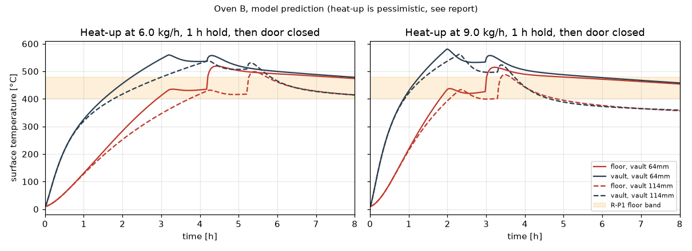

# Phase 2 report: Physics model

Date: 2026-11-07. Status: **waiting for user review**.
Model description, verification table and limitations: `docs/model.md`.
Raw results: `phase-2-results.json`, `phase-2-sensitivity.json`, `../../validation/f22_calibration.json`.

## 1. What was built
| Part | Code | Checked against |
|---|---|---|
| 1D layered conduction (flat/cylinder/sphere, k(T), radiation BCs) | `simulation/conduction.py` | 8 exact solutions (`tests/test_conduction.py`) |
| Cavity view factors + radiosity network | `simulation/radiation.py` | closed-form view factors and two-surface exchange (`tests/test_radiation.py`) |
| Fire as an empirical heat source + two-zone mouth flow | `simulation/fire.py`, `oven.py` | energy conservation (steady 0.2 %, transient 2 %) |
| External natural convection | `simulation/convection.py` | Churchill–Chu correlations, CoolProp air |
| Thermal expansion | `simulation/expansion.py` | geometric identities |
| Calibration + validation on the published oven | `validation/f22.py` | Falciano et al. 2022/2023 |

Tests: 43 passing.

## 2. Calibration against the published oven: honest result
| Quantity (3 kg/h, steady) | Measured | Model | Off by |
|---|---|---|---|
| Floor | 453 ± 32 °C | 494 °C | +1.3 σ |
| Vault | 546 ± 53 °C | 573 °C | +0.5 σ |
| Flue loss | 46 % | 51 % | +1.0 σ (σ assumed) |
| Wall loss | 26 % | 33 % | +1.3 σ (σ assumed) |

| Initial floor heating rate | Measured (F22 Eq. 8) | Model | |
|---|---|---|---|
| 3 kg/h (calibration) | 147 °C/h | 69 | ✗ |
| 4.5 kg/h (**held out**) | 221 | 116 | ✗ |
| 6 kg/h (**held out**) | 294 | 168 | ✗ |
| 9 kg/h (calibration) | 441 | 285 | ✗ |

**Verdict:**
- **Steady temperatures and losses are acceptable** (within ~1.3 σ).
- **Early heat-up is under-predicted by roughly 1.5–2×**, including at the
  held-out feeds. The model lacks direct ember contact with the floor and
  sideways conduction; the published oven's floor material and pre-heat
  state are also unknown.
- **So every heat-up time below is pessimistic.** I report it as an upper
  bound. The first real firing (Phase 5) will calibrate it.
- Two parameters sit at their limits:
  - radiated share of fire heat: 0.6
  - the published oven's insulation: minimal
  They are poorly identified, so the sensitivity runs give them ±30 %.

The first model version (one well-mixed gas zone) failed calibration outright.
It could not make the vault hotter than the floor. Adding the two-zone mouth
flow (cold air in low, hot gas out high) fixed the steady state. This is
recorded so the step is visible, not hidden.

## 3. Predictions for concept B
Nominal: 10 °C ambient, still air, 0.80 × 0.90 m floor, door 0.52 × 0.24 m.

### Vault thickness: thin (64 mm, bricks laid flat) vs standard (114 mm)
| | **64 mm vault** | 114 mm vault |
|---|---|---|
| Wood to hold floor at 450 °C (steady) | **1.8 kg/h** | 1.8 kg/h |
| Vault at that point | 536 °C | 536 °C |
| Heat-up to 430 °C floor at 6 kg/h (pessimistic) | **190 min** (19 kg) | 252 min (25 kg) |
| Heat-up at 9 kg/h (pessimistic) | **118 min** (18 kg) | 138 min (21 kg) |
| Vault brick mass | ~½ | 1 |

The thin vault heats up 15–25 % faster for the same holding wood rate, with
about half the brick. **Recommended: 64 mm**, subject to an arch stability
(thrust-line) check in Phase 3.

### Where the heat goes (holding 450 °C floor, 64 mm vault, 100 mm insulation)
| | kW | share |
|---|---|---|
| Flue gas (through the mouth) | 3.8 | 52 % |
| **Radiation out of the door** | **2.7** | **36 %** |
| Walls and floor | 0.9 | 12 % |
| Fire output (1.8 kg/h) | 7.4 | 100 % |

Insulation has done its job: wall loss is 12 % here against 26–33 % in the
published oven, and that is why we need ~1.8 kg/h where it needs 3 kg/h. The
big remaining loss is the 52 cm door, which the 45 cm pizza requires.

### Heat-up time against R-P2 (≤ 90 min)
- The model, which is pessimistic, gives 118 min at 9 kg/h.
- If the published-oven bias carries over, the real oven is likely 60–120 min.
- **R-P2 is not demonstrated by the model.** It is plausible at high feed, and
  normal practice helps: lighting the fire in the middle of the floor first,
  then moving it to the back. The model cannot represent that.
- Proposal: keep R-P2 and verify it at first firing.

### Touch temperature (R-S1) and insulation thickness
Steady state is a long-session upper bound. 40 °C ambient, still air, floor
held at 450 °C:

| Vault insulation (Superwool-equivalent) | 50 mm | 75 mm | 100 mm | **125 mm** | 150 mm |
|---|---|---|---|---|---|
| Shell temperature | 83 °C | 72 °C | 65 °C | **61 °C** | 58 °C |

- At the 10 °C nominal ambient, 100 mm gives about 35–39 °C.
- Shell temperature is driven almost entirely by the blanket's conductivity
  (63–69 °C over its uncertainty band at 100 mm).
- **Recommendation: 125–150 mm equivalent.** Three cheaper measures together
  hold ≤ 60 °C even in a long session on a 40 °C day:
  - **Hybrid insulation:** 50 mm Superwool on the hot side, plus mineral
    (rock) wool outside it, where temperatures are low. Five Superwool
    layers alone would cost ~$600, which strains the budget. The rock-wool
    product and its temperature limit get sourced in Phase 3.
  - **A ventilated air gap** under the outer shell, studied in Phase 3.
  - **Insulating grips and labels** on any metal handle.

### Concrete base (R-I2, limit 100 °C is an ASSUMPTION)
| Floor CaSi insulation | 50 mm | 75 mm | **100 mm** |
|---|---|---|---|
| Concrete top, steady, 10 °C ambient | 131 °C | 107 °C | **93 °C** |
| Concrete top, steady, 40 °C ambient | 147 °C | 126 °C | 113 °C |

- In a 1 h session the concrete stays below these steady values (about
  80–100 °C at 50 mm).
- **Recommendation: 100 mm CaSi** (4 layers), about $60 more.
- For long sessions on hot days, a 20–30 mm ventilated gap or one more layer
  would also be needed.
- The 100 °C limit still has to be confirmed from an authorised copy of EN 1992-1-2.

### Thermal expansion (α proxy ±20 %)
| Movement at operating temperature | Size | Design response |
|---|---|---|
| Arch span growth (if free) | 2.7–4.0 mm | Tie rods with disc-spring stacks, ≥ 8 mm travel |
| Crown lift if the span were held rigid | 2.2–3.4 mm | Don't hold it rigid: springs above |
| Barrel length growth | 3.2–4.8 mm | 5 mm fibre-gasket joints between arch and end walls |
| Floor growth across 0.8–0.9 m | 2.6–3.5 mm | Floating floor, 5 mm fibre-filled perimeter gap, walls not bearing on floor bricks |

Through-thickness strain at steady state is small (1.1 × 10⁻⁴) because the
insulated vault runs nearly isothermal. The heat-up transient is worse, which
is another reason for slow first firings. No stresses are quoted: the brick's
Young's modulus is not sourced, so the design allows movement instead of
relying on strength.

### Heat retention (not a requirement, R-P6)
- With the door closed, the model keeps the floor above 400 °C for 8 h or
  more. That is **optimistic**: the door is modelled as perfectly
  insulating and sealed.
- A real door will leak, so treat this as "very good retention, quantity unknown".
- When the door closes, the floor rises ~80 °C, because inflowing air is no
  longer sweeping it.

## 4. Sensitivity (one-at-a-time, `phase-2-sensitivity.json`)
| Input (range) | Wood at 450 °C (base 1.83 kg/h) | Heat-up at 6 kg/h (base 190 min) | Shell at 40 °C (base 65 °C) |
|---|---|---|---|
| Excess air (1.3–2.4) | **1.49–2.21** | 171–208 | – |
| Radiated fraction χr (0.42–0.6) | 1.83–2.05 | **190–235** | – |
| In-cavity h (7.7–14.4) | 1.66–2.00 | 182–199 | 64–66 |
| Brick cp (−12/+5 %) | – | 170–199 | – |
| Brick k (−30/+25 %) | – | 176–197 | – |
| Brick emissivity (−20/+5 %) | 1.80–1.99 | 189–201 | – |
| Burn time constant (7.5–30 min) | – | 184–205 | – |
| Superwool k (−10/+20 %) | 1.80–1.88 | – | **63–69** |
| CaSi k, concrete k, brick ρ, paint ε | small | small | < 1 °C |

- **Wood use and heat-up are governed by the fire and flow parameters**, which
  only real measurement can pin down. Phase 4's measurement plan must target
  them: flue or mouth gas temperature, and wood mass log.
- **Shell temperature is governed by insulation conductivity and thickness**,
  which we control by design.

## 5. Requirement amendments proposed (need your approval)
- **R-P1a:** record "≈ 1.5–2.2 kg/h to hold a 450 °C floor (model)". This stays informative, not a limit.
- **R-P2:** keep ≤ 90 min, marked "model upper bound 118 min at 9 kg/h; verify at first firing".
- **R-I2:** floor insulation ≥ 100 mm CaSi. The concrete limit stays an ASSUMPTION to verify.
- **Design (not requirements):**
  - 64 mm vault
  - ≥ 125 mm equivalent vault insulation (hybrid)
  - expansion provisions as in §3

## 6. Open questions and limits
- **Floor recovery after a pizza (R-P5)** is not modelled yet (needs a
  pizza/floor contact model). It goes to Phase 3, or to measurement.
- **Top-heat evenness of a barrel vault (K-19)** is not resolved: the vault is
  one isothermal surface in this model.
- **Thin-arch stability** needs a thrust-line check (Phase 3).
- **EN ISO 13732-1 and EN 1992-1-2** are needed as authorised copies to close
  K-22 and the concrete limit.

## Decisions needed
- **D1.** Vault 64 mm (recommended) or 114 mm?
- **D2.** Approve the R-P1a / R-P2 / R-I2 amendments above?
- **D3.** Go to Phase 3 (detailed CAD, BOM with local quotes, DXF/cut lists, arch stability check, hybrid insulation sourcing)?
